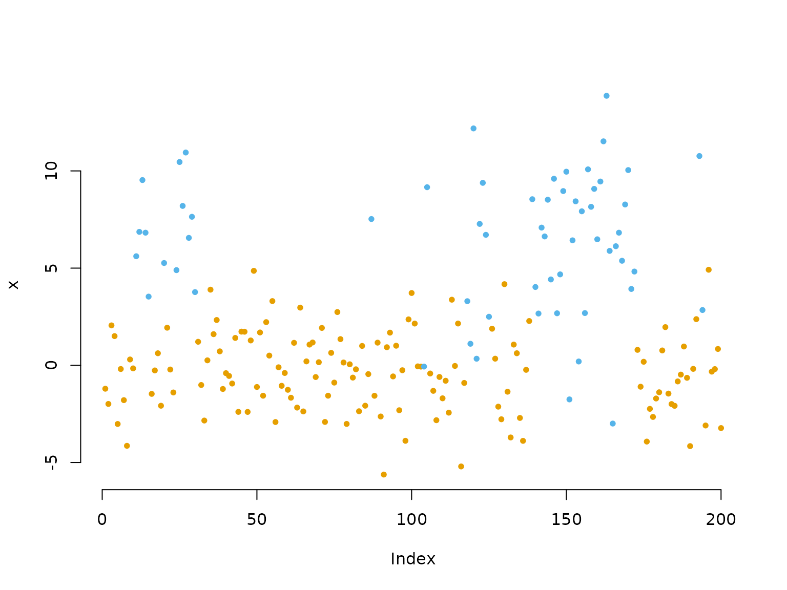
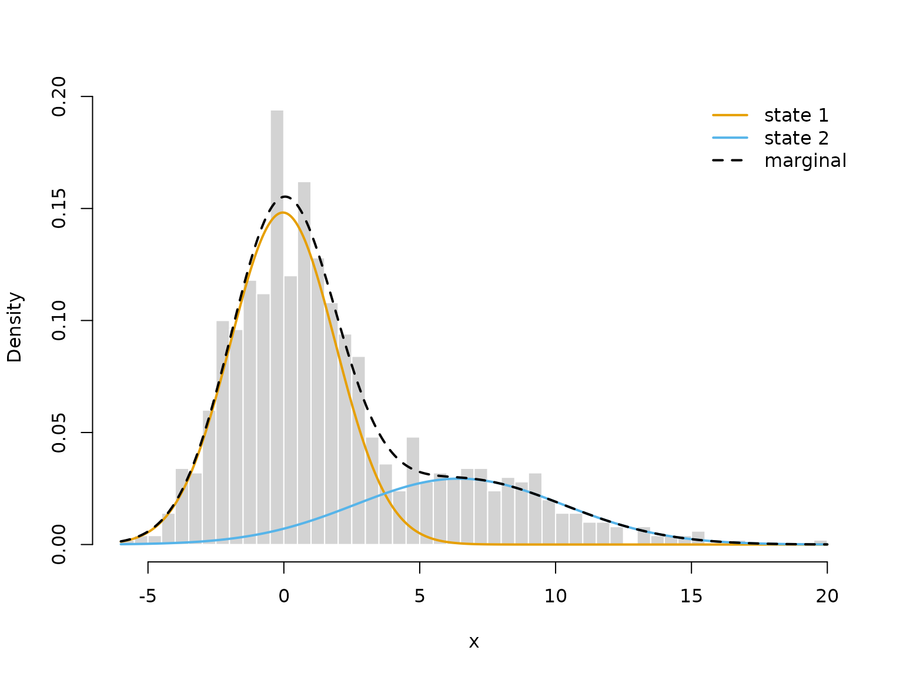
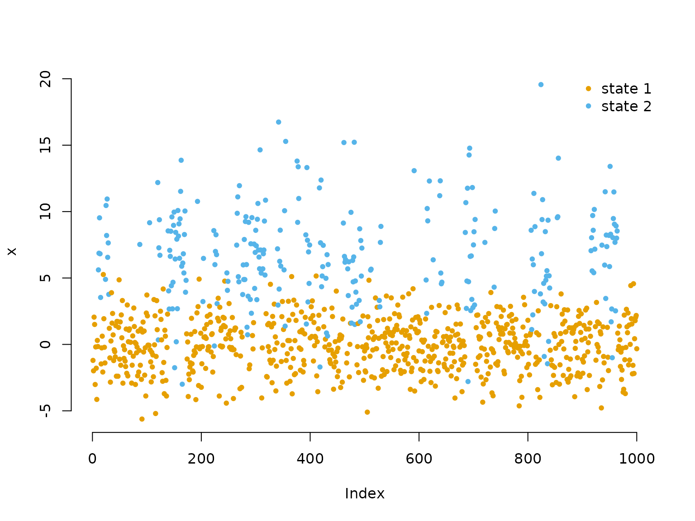
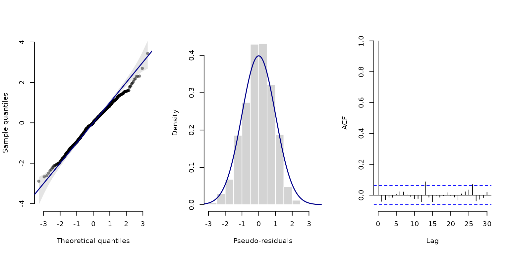
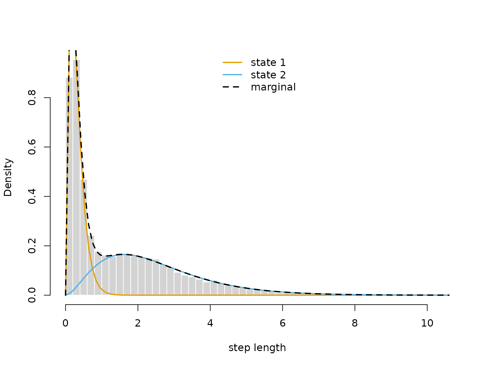

# 2 Finer control

> Before diving into this vignette, we recommend reading the vignette
> [**Introduction to
> LaMa**](https://janolefi.github.io/LaMa/articles/Intro_to_LaMa.html).

In the introduction, we used a few shortcuts:
[`statedens()`](https://janolefi.github.io/LaMa/reference/statedens.md)
built the matrix of state-dependent densities,
`forward("stationary", ...)` computed the initial distribution, and
[`lama()`](https://janolefi.github.io/LaMa/reference/lama.md) gave us a
model object for decoding, residuals and plots. Each of them is code you
can also write yourself – with automatic differentiation just as without
– which gives arbitrarily fine control. You need this as soon as a model
does not fit the shortcuts, e.g. for a custom initial distribution,
densities transformed by hand, or other model classes like
continuous-time HMMs, state space models or hidden semi-Markov models.

In this vignette, we first explain how the HMM likelihood is computed
and fit a simple HMM without automatic differentiation to see all
building blocks at work. We then write the likelihood of the `trex`
model from the introduction by hand, using `RTMB` as before.

``` r

library(LaMa)
#> Loading required package: RTMB
```

## The HMM likelihood

Computing the HMM likelihood for observations x_1, \dots, x_T is
non-trivial, as we do not observe the underlying states and need to *sum
out* all possible state sequences. Exploiting the Markov property, the
so-called **forward algorithm** does this recursively as a matrix
product:

L(\boldsymbol{\theta}) = \boldsymbol{\delta}^{(1)} \boldsymbol{P}(x_1)
\boldsymbol{\Gamma} \boldsymbol{P}(x_2) \boldsymbol{\Gamma} \dots
\boldsymbol{\Gamma} \boldsymbol{P}(x_T) \boldsymbol{1}^\top, where
\boldsymbol{\delta}^{(1)} and \boldsymbol{\Gamma} are the initial
distribution and the transition probability matrix, \boldsymbol{P}(x_t)
is a diagonal matrix with the state-dependent densities (or probability
mass functions) f_j(x_t) = f(x_t \mid S_t = j) on its diagonal,
\boldsymbol{1} is a row vector of ones and \boldsymbol{\theta} contains
all model parameters. In practice,
[`forward()`](https://janolefi.github.io/LaMa/reference/forward.md) does
not compute this likelihood directly, but its logarithm via a scaling
strategy ([Zucchini et al. 2016](#ref-zucchini)).

Many parameters are constrained, e.g. standard deviations are positive
and the rows of the transition probability matrix sum to one. Instead of
constrained optimisation, we maximise the likelihood w.r.t.
unconstrained parameters (`par` in the code), which are transformed by
link functions: e.g. the log link for positive parameters and the
multinomial logistic link (softmax) for the transition probability
matrix, implemented in
[`tpm()`](https://janolefi.github.io/LaMa/reference/tpm.md).

For efficiency, the state-dependent densities are evaluated vectorised
before running the forward algorithm. This gives a matrix with one row
per observation and one column per state, which, throughout the package,
we call the `allprobs` matrix.

## Fitting an HMM without automatic differentiation

[`forward()`](https://janolefi.github.io/LaMa/reference/forward.md) and
the other building blocks also work without automatic differentiation.
They are then still worth using: without AD,
[`forward()`](https://janolefi.github.io/LaMa/reference/forward.md) runs
in `C++`, as does
[`tpm()`](https://janolefi.github.io/LaMa/reference/tpm.md) for many
time-varying transition probability matrices, which is much faster than
writing the forward algorithm yourself in `R`. To see all parts in
action, we simulate data from a 2-state HMM with Gaussian
state-dependent distributions and fit it with
[`nlm()`](https://rdrr.io/r/stats/nlm.html).

### Generating data from a 2-state HMM

``` r

# parameters
mu = c(0, 6)    # state-dependent means
sigma = c(2, 4) # state-dependent standard deviations
Gamma = matrix(c(0.95, 0.05, # transition probability matrix
                 0.15, 0.85),
               nrow = 2, byrow = TRUE)
delta = stationary(Gamma) # stationary distribution

# simulation
n = 1000
set.seed(123)
s = rep(NA, n)
s[1] = sample(1:2, 1, prob = delta) # sampling first state from delta
for(t in 2:n){
  # drawing the next state conditional on the last one
  s[t] = sample(1:2, 1, prob = Gamma[s[t-1],])
}
# drawing the observation conditional on the states
x = rnorm(n, mu[s], sigma[s]) # independent given the state sequence

color = LaMaColors(2)
plot(x[1:200], bty = "n", pch = 20, ylab = "x",
     col = color[s[1:200]])
```



### Inference by direct numerical maximum likelihood estimation

Within the negative log-likelihood function we

1.  build the transition probability matrix using the
    [`tpm()`](https://janolefi.github.io/LaMa/reference/tpm.md)
    function,
2.  compute the stationary distribution of the Markov chain using
    [`stationary()`](https://janolefi.github.io/LaMa/reference/stationary.md),
3.  build the `allprobs` matrix, and
4.  calculate the log-likelihood using
    [`forward()`](https://janolefi.github.io/LaMa/reference/forward.md),
    returning -1 times it for minimisation.

``` r

nll = function(par, x){
  # 1) Transition probability matrix
  Gamma = tpm(par[1:2]) # multinomial logistic link (softmax)
  # 2) Stationary distribution for this matrix
  delta = stationary(Gamma) # will be used as initial
  # Parameter transformations for unconstrained optimisation
  mu = par[3:4] # no transformation needed
  sigma = exp(par[5:6]) # strictly positive
  # 3) Calculating state-dependent densities outside the forward algorithm
  allprobs = matrix(1, length(x), 2)
  for(j in 1:2) allprobs[,j] = dnorm(x, mu[j], sigma[j])
  # 4) Run the forward algorithm
  -forward(delta, Gamma, allprobs)
}
```

The shortcut `statedens(x, dnorm, mu, sigma)` would give the same matrix
as the loop in step 3, and `forward("stationary", Gamma, allprobs)`
would replace step 2.

We fit the model with [`nlm()`](https://rdrr.io/r/stats/nlm.html),
starting from initial values on the unconstrained scale. As
[`tpm()`](https://janolefi.github.io/LaMa/reference/tpm.md) uses the
softmax link, an off-diagonal probability p corresponds to the starting
value `qlogis(p)`; here we start near 0.05. In practice, it is advisable
to try several sets of initial values to find the global maximum.

``` r

par = c(logitGamma = qlogis(c(0.05, 0.05)),
        mu = c(1,4),
        logsigma = c(log(1),log(3)))
# initial transformed parameters: not chosen too well
system.time(
  opt <- nlm(nll, par, x = x)
)
#>    user  system elapsed 
#>   0.132   0.006   0.138
```

This is fast because
[`forward()`](https://janolefi.github.io/LaMa/reference/forward.md) runs
in `C++`. With the forward algorithm written in `R`, the same fit takes
roughly three times as long.

With AD, we can use the same likelihood function, only wrapped into a
function of a parameter list:

``` r

system.time({
  obj = MakeADFun(function(p) nll(p$par, x), list(par = par), silent = TRUE)
  opt_ad <- nlminb(obj$par, obj$fn, obj$gr)
})
#>    user  system elapsed 
#>   0.143   0.000   0.143
```

For such a small and simple model, it hardly matters whether we use AD.
For larger models, however, it matters a lot: without AD, the gradient
is approximated by finite differences, which costs one additional
likelihood evaluation per parameter and is less accurate. For example, a
3-state model for the `trex` step lengths and turning angles (15
parameters) takes about 8 seconds to fit without and about 1 second with
AD. The exact gradient also makes the optimisation numerically more
stable.

### Visualising results

Without `RTMB`, there is no model object, so we need to back-transform
the estimated parameters ourselves, as in the likelihood:

``` r

estimate = opt$estimate
# transform parameters to natural scale
Gamma = tpm(estimate[1:2])
delta = stationary(Gamma) # stationary HMM
mu = estimate[3:4]
sigma = exp(estimate[5:6])

hist(x, prob = TRUE, bor = "white", breaks = 40, main = "")
curve(delta[1]*dnorm(x, mu[1], sigma[1]), add = TRUE, lwd = 2, col = color[1], n=500)
curve(delta[2]*dnorm(x, mu[2], sigma[2]), add = TRUE, lwd = 2, col = color[2], n=500)
curve(delta[1]*dnorm(x, mu[1], sigma[1])+delta[2]*dnorm(x, mu[2], sigma[2]),
      add = TRUE, lwd = 2, lty = "dashed", n=500)
legend("topright", col = c(color, "black"), lwd = 2, bty = "n",
       lty = c(1,1,2), legend = c("state 1", "state 2", "marginal"))
```



To decode the most probable state sequence with
[`viterbi()`](https://janolefi.github.io/LaMa/reference/viterbi.md), we
first compute the `allprobs` matrix:

``` r

allprobs = matrix(1, length(x), 2)
for(j in 1:2) allprobs[,j] = dnorm(x, mu[j], sigma[j])

states = viterbi(delta, Gamma, allprobs)

plot(x, pch = 20, bty = "n", col = color[states])
legend("topright", pch = 20, legend = c("state 1", "state 2"),
       col = color, box.lwd = 0)
```



For **pseudo-residuals**,
[`pseudo_res()`](https://janolefi.github.io/LaMa/reference/pseudo_res.md)
needs the observations, the parametric family, the estimated parameters
and the local state probabilities:

``` r

probs = stateprobs(delta, Gamma, allprobs) # local state probabilities

pres = pseudo_res(x, # observations
                  "norm", # parametric distribution to use
                  list(mean = mu, sd = sigma), # parameters for that distribution
                  probs) # local state probabilities

# use the plotting method for LaMaResiduals
plot(pres)
```



In this case, our model looks really good – which it should because it
is correctly specified.

## Writing everything yourself with RTMB

Writing the likelihood explicitly works just the same with automatic
differentiation. We return to the `trex` model from the introduction:

``` r

par = list(
  log_mu = log(c(0.3, 1)),      # initial means for step length (log-transformed)
  log_sigma = log(c(0.2, 0.7)), # initial sds for step length (log-transformed)
  eta = rep(-2, 2)              # initial t.p.m. parameters (on logit scale)
  )

dat = list(
  step = trex$step,   # hourly step lengths
  N = 2
  )
```

This time, we compute the stationary distribution with
[`stationary()`](https://janolefi.github.io/LaMa/reference/stationary.md)
and build `allprobs` with a loop over states. Rows of missing
observations stay 1, such that they do not contribute to the likelihood
– exactly what
[`statedens()`](https://janolefi.github.io/LaMa/reference/statedens.md)
does.

``` r

nll2 = function(par) {
  getAll(par, dat) # makes everything contained available without $
  Gamma = tpm(eta) # computes transition probability matrix from unconstrained eta
  delta = stationary(Gamma) # computes stationary distribution
  # Parameter transformations for strictly positive parameters
  mu = exp(log_mu)
  sigma = exp(log_sigma)
  # Reporting statements for later use
  REPORT(mu); ADREPORT(mu)
  REPORT(sigma); ADREPORT(sigma)
  # Calculating all state-dependent densities
  allprobs = matrix(1, nrow = length(step), ncol = N)
  ind = which(!is.na(step)) # only for non-NA obs.
  for(j in 1:N){
    allprobs[ind,j] = dgamma2(step[ind], mu[j], sigma[j])
  }
  -forward(delta, Gamma, allprobs) # simple forward algorithm
}

obj2 = MakeADFun(nll2, par, silent = TRUE)
opt2 = nlminb(obj2$par, obj2$fn, obj2$gr)
mod2 = lama(obj2)
```

This gives the same fit as the short version in the introduction:

``` r

-opt2$objective
#> [1] -10847.12
mod2$Gamma
#>           S1        S2
#> S1 0.8269542 0.1730458
#> S2 0.1608473 0.8391527
```

Writing the likelihood explicitly gives full control over each part.
Throughout the vignettes, you will see examples of this, e.g.

- a custom initial distribution, like an estimated one for inhomogeneous
  models (see
  [**Extensions**](https://janolefi.github.io/LaMa/articles/Extensions.html)),
- the periodically stationary distribution computed by
  [`stationary_p()`](https://janolefi.github.io/LaMa/reference/stationary_p.md)
  instead of `forward("stationary", ..., tod = tod)`, to report it for
  all times of day (see
  [**Extensions**](https://janolefi.github.io/LaMa/articles/Extensions.html)),
- state-dependent densities transformed by hand, e.g. for zero-inflation
  or smooth densities (see [**Penalised
  splines**](https://janolefi.github.io/LaMa/articles/Penalised_splines.html)),
  or
- transition probability matrices computed in a different way, e.g. for
  continuous-time HMMs or hidden semi-Markov models.

### Downstream functions

With automatic differentiation,
[`forward()`](https://janolefi.github.io/LaMa/reference/forward.md)
always reports `delta`, `Gamma` and `allprobs`, no matter how they were
computed. The
[`viterbi()`](https://janolefi.github.io/LaMa/reference/viterbi.md) and
[`stateprobs()`](https://janolefi.github.io/LaMa/reference/stateprobs.md)
functions either take these as arguments or, more conveniently, the
whole reported `mod` object as an input:

``` r

states = viterbi(mod2$delta, mod2$Gamma, mod2$allprobs)
all.equal(states, viterbi(mod2))
#> [1] TRUE
```

For this to work,
[`forward()`](https://janolefi.github.io/LaMa/reference/forward.md)
should only be called once in the likelihood function, with the
`trackID` argument for several tracks (see the vignette on
[**Longitudinal
data**](https://janolefi.github.io/LaMa/articles/Longitudinal_data.html)).

`pseudo_res(mod)` evaluates the likelihood function again with the
densities replaced by their CDFs, which also works with an `allprobs`
matrix built by hand. Alternatively, we can specify the observations,
the parametric family and the estimated parameters manually:

``` r

pres_step = pseudo_res(obs = trex$step, # observation sequence
                       dist = "gamma2", # which parametric CDF to use
                       par = list(mean = mod2$mu, sd = mod2$sigma), # estimated pars for that CDF
                       mod = mod2) # model object
all.equal(pres_step, pseudo_res(mod2))
#> [1] TRUE
```

This is needed when the densities are transformed by hand inside the
likelihood, e.g. for zero-inflation, where swapping in CDFs is not
valid. `plot(pres_step)` then gives the same plots as `plot(mod2)`.

Similarly, `plot(mod, type = "statedens")` needs the information
recorded by
[`statedens()`](https://janolefi.github.io/LaMa/reference/statedens.md).
With a hand-built `allprobs` matrix, we plot the estimated
state-dependent distributions ourselves:

``` r

delta = mod2$delta
mu = mod2$mu
sigma = mod2$sigma

hist(trex$step, prob = TRUE, breaks = 40,
     bor = "white", main = "", xlab = "step length")
for(j in 1:2) curve(delta[j] * dgamma2(x, mu[j], sigma[j]),
                    lwd = 2, add = TRUE, col = color[j])
curve(delta[1]*dgamma2(x, mu[1], sigma[1]) + delta[2]*dgamma2(x, mu[2], sigma[2]),
      lwd = 2, lty = 2, add = TRUE)
legend("top", lwd = 2, lty = c(1, 1, 2), col = c(color, "black"), bty = "n",
       legend = c("state 1", "state 2", "marginal"))
```



## Uncertainty quantification

`sdreport()` gives standard errors for the unconstrained parameters and
for all
[`ADREPORT()`](https://rdrr.io/pkg/RTMB/man/TMB-interface.html)ed
quantities, the latter based on the delta method:

``` r

sdr = sdreport(obj2)
summary(sdr) # see ?summary.sdreport for more info
#>             Estimate  Std. Error
#> log_mu    -1.1923951 0.011461828
#> log_mu     0.9185717 0.009076411
#> log_sigma -1.6018327 0.016858309
#> log_sigma  0.3993241 0.013479572
#> eta       -1.6519372 0.042684391
#> eta       -1.5641927 0.041157505
#> mu         0.3034935 0.003478590
#> mu         2.5057090 0.022742845
#> sigma      0.2015268 0.003397402
#> sigma      1.4908167 0.020095571
```

The estimates and standard errors are also available in list format:

``` r

as.list(sdr, "Estimate") # estimated parameters
as.list(sdr, "Std")      # their standard errors
as.list(sdr, "Estimate", report = TRUE) # ADREPORT()ed quantities
as.list(sdr, "Std", report = TRUE)      # their standard errors
```

The delta method is not advisable for complex non-linear
transformations. In this case,
[`MCreport()`](https://janolefi.github.io/LaMa/reference/MCreport.md)
draws samples of the parameters from the approximate normal distribution
of the MLE, which can then be transformed by any function (see
[**Extensions**](https://janolefi.github.io/LaMa/articles/Extensions.html)
for an example).

## Tips and common issues

There are some commonly occurring issues with `RTMB` to keep in mind. I
list the main ones I have encountered here – please let me know if you
encounter more so they can be added.

#### Non-standard distributions

If you need a non-standard probability distribution, existing
implementations will likely fail due to AD incompatibility. Check
whether the distribution is available in
[`RTMBdist`](https://janolefi.github.io/RTMBdist/), which provides a
library of AD-compatible distributions for use inside likelihood
functions.

#### Operator overloading

A typical issue is that some operators may need to be overloaded to
allow for automatic differentiation. In typical model setups `LaMa`
functions handle this automatically, but if you take a more
individualistic route and encounter an error like

``` r

stop("Invalid argument to 'advector' (lost class attribute?)")
```

you might have to overload the operator yourself. To do this put

``` r

"[<-" <- ADoverload("[<-")
```

as the first line of your likelihood function. If the error still
prevails also add

``` r

"c" <- ADoverload("c")
"diag<-" <- ADoverload("diag<-")
```

which should hopefully fix the error.

#### Initialising with `NA`

A common problem occurs when initialising objects with `NA` values and
then filling them with `numeric` values. `NA` is logical, which causes
type mismatches that break automatic differentiation. Always initialise
with `numeric` or `NaN` values instead. For example, avoid

``` r

X = array(dim = c(1,2,3))
# which is the same as
X = array(NA, dim = c(1,2,3))
```

and use

``` r

X = array(NaN, dim = c(1,2,3))
# or
X = array(0, dim = c(1,2,3))
```

#### Wrapping arrays in `AD()`

If you create an array and fill it with something parameter-dependent,
wrap it in [`AD()`](https://rdrr.io/pkg/RTMB/man/AD.html):

``` r

X <- AD(array(...))
```

This ensures `X` is an AD object from the start and that classes are
compatible. Wrapping in [`AD()`](https://rdrr.io/pkg/RTMB/man/AD.html)
is generally a good idea to resolve the above error, as it introduces no
meaningful overhead when not needed.

#### No `if` statements on parameters

You cannot use `if` statements **on parameters directly**, as these are
not differentiable. `RTMB` builds the *tape* (computational graph) at
the initial parameter value, so `if` branches depending on a parameter
will produce gradients that are wrong elsewhere. `RTMB` will fail,
likely without a helpful error message. `if` statements that do not
involve parameters are typically fine, since the branch is fixed
throughout optimisation.

#### Byte compiler side effects

Some unfortunate side effects of `R`’s byte compiler (enabled by
default) can interfere with `RTMB`. If you encounter an error not
covered above, try disabling it with

``` r

compiler::enableJIT(0)
#> [1] 3
```

#### Further reading

For more information on `RTMB`, see its
[documentation](https://CRAN.R-project.org/package=RTMB) or the [TMB
users Google group](https://groups.google.com/g/tmb-users).

> Continue reading with
> [**Extensions**](https://janolefi.github.io/LaMa/articles/Extensions.html).

## References

Zucchini, Walter, Iain L. MacDonald, and Roland Langrock. 2016. *Hidden
Markov Models for Time Series: An Introduction Using R*. Boca Raton:
Chapman & Hall/CRC.
