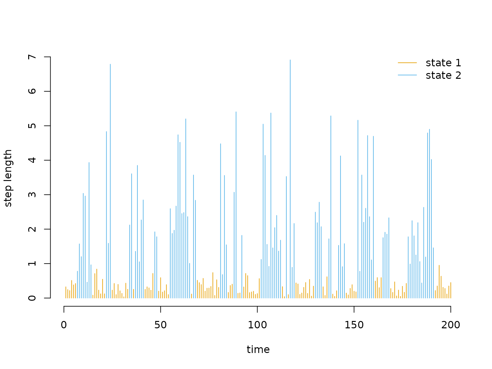
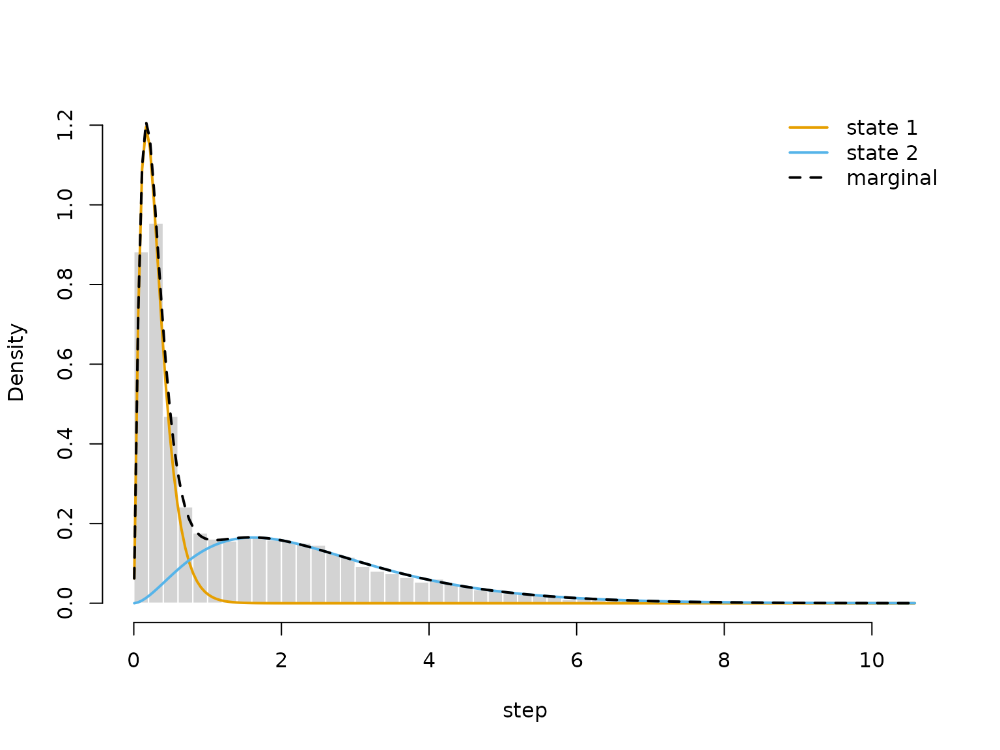
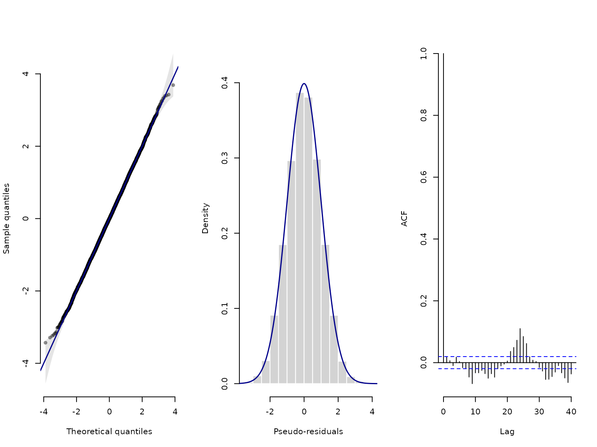

# 1 Introduction to LaMa

The `R` package `LaMa` provides convenient functions for fitting a
variety of **latent Markov models**, including **hidden Markov models**
(HMMs), **hidden semi-Markov models** (HSMMs), **state space models**
(SSMs) and **continuous-time** variants via **direct numerical maximum
likelihood estimation**. The core idea underlying this package is given
in Mews et al. ([2025](#ref-mews2024build)), namely for all these models
the likelihood function has the same structure, and hence unification of
inference procedures is attractive.

Model specification in `LaMa` amounts to defining a **custom likelihood
function** using provided building blocks – similar to stacking Legos.
This approach is different (and arguably more difficult) than model
specification in packages like `moveHMM`, `momentuHMM`, or `hmmTMB`. The
modular approach, however, has the advantage of being more flexible.
Specifying simple models is still very easy and convenient while model
complexity can be increased to an arbitrary level and arbitrarily fine
control is available for advanced users.

In this vignette, we show the simple way: with **automatic
differentiation** (AD), a basic HMM takes only a few lines of code, and
the fitted model object gives state decoding, residuals, plots and
simulation for free. The vignette [**Finer
control**](https://janolefi.github.io/LaMa/articles/Finer_control.html)
then shows what the convenience functions do, and how to write every
part yourself.

## Hidden Markov models

We start from the most basic hidden Markov model (HMM). An N-state HMM
is a doubly stochastic process in discrete time: observations are
generated by one of N possible distributions f_j(x_t), j = 1, \dots, N,
and an unobserved **N-state Markov chain** selects which distribution is
active at any given time point. Hence, HMMs are temporally-dependent
mixture models, popular in ecology, sports, finance and many other
fields (see Zucchini et al. ([2016](#ref-zucchini)) for a detailed
introduction). The two main model assumptions are:

1.  f(s_t \mid s\_{t-1}, s\_{t-2}, \dots, s_1) = f(s_t \mid s\_{t-1})
    (Markov assumption)
2.  f(x_t \mid x_1, \dots, x\_{t-1}, x\_{t+1}, \dots, x_T, s_1, \dots,
    s_T) = f(x_t \mid s_t) (conditional independence assumption).

The hidden state process is described by an N-state Markov chain which
is fully characterised by its **initial distribution**
\boldsymbol{\delta}^{(1)} = (\Pr(S_1 = 1), \dots, \Pr(S_1 = N)) and the
one-step **transition probabilities** \gamma\_{ij} = \Pr(S_t = j \mid
S\_{t-1} = i), \quad i,j = 1, \dotsc, N. These are typically summarised
in a **transition probability matrix** (t.p.m.) \boldsymbol{\Gamma} =
(\gamma\_{ij})\_{i,j = 1, \dots, N}, where row i is the conditional
one-step-ahead distribution of the state process given that the current
state is i. For example a t.p.m. for a two-state Markov chain could be

``` r

library(LaMa)
#> Loading required package: RTMB

(Gamma = matrix(c(0.9, 0.1,
                  0.2, 0.8), nrow = 2, byrow = TRUE))
#>      [,1] [,2]
#> [1,]  0.9  0.1
#> [2,]  0.2  0.8
```

We often assume that the Markov chain is **stationary**, i.e. that it
has been running for a long time before our observations started –
e.g. when observing an animal’s behavioural states. The initial
distribution is then the stationary distribution \boldsymbol{\delta},
which solves \boldsymbol{\delta} \boldsymbol{\Gamma} =
\boldsymbol{\delta}, \quad \text{s.t.} \\ \sum\_{j=1}^N \delta_j = 1,
and is computed by
[`stationary()`](https://janolefi.github.io/LaMa/reference/stationary.md):

``` r

(delta = stationary(Gamma))
#>        S1        S2 
#> 0.6666667 0.3333333
```

It can be interpreted as the long-run proportion of time spent in each
state. For the state-dependent distributions f_j(x_t), a typical choice
is a parametric family like normal or gamma distributions with
state-specific means and standard deviations.

As we do not observe the states, the likelihood sums over all possible
state sequences. This is done efficiently by the **forward algorithm**,
implemented in
[`forward()`](https://janolefi.github.io/LaMa/reference/forward.md) (see
[**Finer
control**](https://janolefi.github.io/LaMa/articles/Finer_control.html)
for details) – for fitting models, we only need to provide the
ingredients.

## Automatic differentiation via RTMB

`LaMa` fits models using automatic differentiation (AD) via the `RTMB`
package (loaded together with `LaMa`), the `R` interface to Template
Model Builder (TMB, [Kristensen et al. 2016](#ref-kristensen2016tmb)).
You write the likelihood as plain `R` code, and `RTMB` provides fast and
*exact* derivatives (without doing any calculations by hand!). This
makes model fitting fast and robust, and even complex models with random
effects feasible.

As an example, we analyse the `trex` data set contained in the package.
It contains hourly step lengths of a Tyrannosaurus rex, living 66
million years ago, and we aim to understand its behavioural process
using HMMs.

``` r

head(trex, 5)
#>   tod      step     angle state
#> 1   9 0.3252437        NA     1
#> 2  10 0.2458265  2.234562     1
#> 3  11 0.2173252 -2.262418     1
#> 4  12 0.5114665 -2.958732     1
#> 5  13 0.3828494  1.811840     1
```

The workflow is always the same. We

1.  define the negative log-likelihood function,
2.  turn it into an AD objective function, and
3.  fit the model by numerical optimisation of the latter.

We fit a stationary 2-state HMM with state-dependent gamma distributions
for the step lengths. First, we define a list `par` of initial parameter
values on an unconstrained (real-valued) scale, and a list `dat` with
the data and other fixed quantities. The number of states follows from
the parameters, here two means and standard deviations.

``` r

par = list(
  log_mu = log(c(0.3, 1)),      # initial means for step length (log-transformed)
  log_sigma = log(c(0.2, 0.7)), # initial sds for step length (log-transformed)
  eta = rep(-2, 2)              # initial t.p.m. parameters (on logit scale)
  )

dat = list(
  step = trex$step   # hourly step lengths
  )
```

Because `par` is a named list, we can access parameters by name. The
likelihood consists of three building blocks:
[`tpm()`](https://janolefi.github.io/LaMa/reference/tpm.md) computes the
transition probability matrix from unconstrained parameters,
[`statedens()`](https://janolefi.github.io/LaMa/reference/statedens.md)
computes the density of each observation in each state (the `allprobs`
matrix, with missing observations handled automatically), and
[`forward()`](https://janolefi.github.io/LaMa/reference/forward.md)
computes the log-likelihood from these two, here with the stationary
distribution of `Gamma` as initial distribution.

``` r

nll = function(par) {
  getAll(par, dat) # makes everything contained available without $
  Gamma = tpm(eta) # computes transition probability matrix from unconstrained eta
  # Parameter transformations for strictly positive parameters
  mu = exp(log_mu); REPORT(mu)
  sigma = exp(log_sigma); REPORT(sigma)
  # State-dependent densities of all observations
  allprobs = statedens(step, dgamma2, mu, sigma)
  -forward("stationary", Gamma, allprobs) # forward algorithm, stationary initial distribution
}
```

Three things differ from an ordinary `R` function:

- **Only parameters are passed.** `nll` takes `par` as its only
  argument, and `getAll(par, dat)` makes all parameters and data
  available by name. `dat` is read when `MakeADFun()` is called, so
  changes to `dat` after that have **no effect**.
- **Parameters are unconstrained.** Everything in `par` lives on the
  real line and is transformed inside the likelihood, e.g. with
  [`exp()`](https://rdrr.io/r/base/Log.html) for positive parameters.
  [`tpm()`](https://janolefi.github.io/LaMa/reference/tpm.md) does this
  for the transition probabilities.
- **[`REPORT()`](https://rdrr.io/pkg/RTMB/man/TMB-interface.html) keeps
  results.** Reported quantities are available after fitting, so we
  never have to back-transform parameters by hand.

Next, `MakeADFun()` turns `nll` into an AD objective function `obj`,
which contains the objective function `fn` and its gradient `gr`, among
others. Calling them without arguments evaluates them at the initial
parameters:

``` r

obj = MakeADFun(nll, par, silent = TRUE) # silent = TRUE suppresses printing
obj$fn()
#> [1] 16378.66
obj$gr()
#>          [,1]     [,2]    [,3]      [,4]     [,5]      [,6]
#> [1,] 609.4426 -2272.55 94.1283 -12144.32 151.3179 -181.5449
```

We fit the model with [`nlminb()`](https://rdrr.io/r/stats/nlminb.html),
providing the gradient. We do not supply the Hessian, as a quasi-Newton
method that uses gradients only is typically much faster.

``` r

opt = nlminb(obj$par, obj$fn, obj$gr) # minimisation
```

[`lama()`](https://janolefi.github.io/LaMa/reference/lama.md) then runs
the reporting at the estimated parameters and returns a model object.
Printing it gives a short overview, while
[`summary()`](https://rdrr.io/r/base/summary.html) shows the estimated
state process (transition probability matrix, stationary distribution
and mean dwell times) and all reported quantities:

``` r

mod = lama(obj)
mod
#> Latent Markov model with 2 states (discrete time, homogeneous)
#> 9999 observations (1 missing), 6 parameters
#> Log-likelihood: -10847.12   AIC: 21706.25   BIC: 21749.51
#> Reported: mu, sigma, delta, Gamma, allprobs
summary(mod)
#> Latent Markov model with 2 states (discrete time, homogeneous)
#> 9999 observations (1 missing), 6 parameters
#> 
#> Transition probability matrix:
#>        S1     S2
#> S1 0.8270 0.1730
#> S2 0.1608 0.8392
#> 
#> Stationary distribution:
#>     S1     S2 
#> 0.4817 0.5183 
#> 
#> Mean dwell times:
#>    S1    S2 
#> 5.779 6.217 
#> 
#> Reported quantities:
#>           S1    S2
#> mu    0.3035 2.506
#> sigma 0.2015 1.491
#> 
#> Log-likelihood: -10847.12   AIC: 21706.25   BIC: 21749.51
#> Maximum gradient component: 0.0141
```

All reported quantities are elements of `mod`. Besides our own
[`REPORT()`](https://rdrr.io/pkg/RTMB/man/TMB-interface.html)s,
[`forward()`](https://janolefi.github.io/LaMa/reference/forward.md)
always reports `delta`, `Gamma` and `allprobs`.
[`AIC()`](https://rdrr.io/r/stats/AIC.html) and
[`BIC()`](https://rdrr.io/r/stats/AIC.html) work as for other models:

``` r

mod$Gamma # estimated t.p.m.
#>           S1        S2
#> S1 0.8269542 0.1730458
#> S2 0.1608473 0.8391527
mod$mu    # estimated state-dependent means
#> [1] 0.3034935 2.5057090
AIC(mod)
#> [1] 21706.25
```

## Working with the fitted model

The model object contains everything needed for downstream tasks. We can
decode the most probable state sequence with
[`viterbi()`](https://janolefi.github.io/LaMa/reference/viterbi.md) and
plot the decoded time series

``` r

mod$states = viterbi(mod)

# defining color vector
color = LaMaColors(2)

plot(trex$step[1:200], type = "h", xlab = "time", ylab = "step length",
     col = color[mod$states[1:200]], bty = "n")
legend("topright", col = color, lwd = 1, legend = c("state 1", "state 2"), bty = "n")
```



or get the local state probabilities with `stateprobs(mod)`.

As
[`statedens()`](https://janolefi.github.io/LaMa/reference/statedens.md)
records the data, densities and parameters, the estimated
state-dependent distributions can be plotted directly from the model
object, weighted by the local state probabilities:

``` r

plot(mod, type = "statedens")
```



We can do some model checking using **pseudo-residuals**, which should
be standard normally distributed if the model is correct.
`pseudo_res(mod)` computes them from the model object alone, and
`plot(mod)` plots them directly (with one row per data stream):

``` r

plot(mod)
```



Finally, [`simulate()`](https://rdrr.io/r/stats/simulate.html) simulates
states and observations from the fitted model, e.g. to check whether it
reproduces features of the data, or for simulation studies:

``` r

sim = simulate(mod)
head(sim)
#>   state     step
#> 1     2 2.827231
#> 2     2 1.838420
#> 3     2 1.242336
#> 4     2 3.102050
#> 5     2 2.325925
#> 6     2 3.812471
```

> Continue reading with [**Finer
> control**](https://janolefi.github.io/LaMa/articles/Finer_control.html)
> to see what the convenience functions do and how to write every part
> yourself, or go straight to
> [**Extensions**](https://janolefi.github.io/LaMa/articles/Extensions.html).

## References

Kristensen, Kasper, Anders Nielsen, Casper W. Berg, Hans Skaug, and
Bradley M. Bell. 2016. “TMB: Automatic Differentiation and Laplace
Approximation.” *Journal of Statistical Software* 70 (5): 1–21.
<https://doi.org/10.18637/jss.v070.i05>.

Mews, Sina, Jan-Ole Koslik, and Roland Langrock. 2025. “How to Build
Your Latent Markov Model: The Role of Time and Space.” *Statistical
Modelling* 25 (6). <https://doi.org/10.1177/1471082X251355681>.

Zucchini, Walter, Iain L. MacDonald, and Roland Langrock. 2016. *Hidden
Markov Models for Time Series: An Introduction Using R*. Boca Raton:
Chapman & Hall/CRC.
