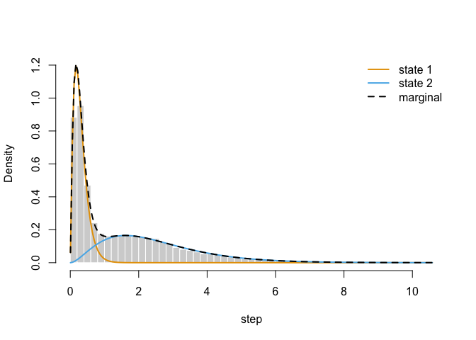

# LaMa - Latent Markov model toolbox 🛠️ 

A variety of [**latent Markov
models**](https://journals.sagepub.com/doi/abs/10.1177/1471082X251355681),
including **hidden Markov models** (HMMs), **hidden semi-Markov models**
(HSMMs), **state-space models** (SSMs) and **continuous-time** variants
can be formulated and fitted within the same framework by directly
maximising the likelihood function calculated using the so-called
**forward algorithm**. Applied researchers often need custom models that
standard software does not easily support. Writing tailored `R` code
offers flexibility but suffers from slow estimation speeds. `LaMa`
solves these issues by providing easy-to-use building-blocks for common
tasks, which can be combined into custom models in a Lego-type approach,
offering very fast estimation speeds. Models are fitted using automatic
differentiation via the `RTMB` package, which makes estimation fast and
accurate and allows for rich random effects structures.

## Installation

You can install the released package version from
[CRAN](https://CRAN.R-project.org) with:

``` r

install.packages("LaMa")
```

or the development version from Github:

``` r

remotes::install_github("janolefi/LaMa")
```

## Package documentation

To aid in building fully custom likelihood functions, this package
contains several vignettes that demonstrate how to simulate data from
and estimate a wide range of models using the functions included in this
package.

HMMs, from simple to complex:

1.  [Introduction to
    LaMa](https://janolefi.github.io/LaMa/articles/Intro_to_LaMa.html)
2.  [Finer
    control](https://janolefi.github.io/LaMa/articles/Finer_control.html)
3.  [Model
    extensions](https://janolefi.github.io/LaMa/articles/Extensions.html)
4.  [Longitudinal
    data](https://janolefi.github.io/LaMa/articles/Longitudinal_data.html)
5.  [Penalised
    splines](https://janolefi.github.io/LaMa/articles/Penalised_splines.html)

Other latent Markov model classes:

6.  [Continuous-time
    models](https://janolefi.github.io/LaMa/articles/Continuous_time_models.html)
7.  [State-space
    models](https://janolefi.github.io/LaMa/articles/State_space_models.html)
8.  [Hidden semi-Markov
    models](https://janolefi.github.io/LaMa/articles/HSMMs.html)

## Introductory example: Homogeneous HMM

We analyse the `trex` data set contained in the package. It contains
hourly step lengths of a Tyrannosaurus rex, living 66 million years ago.
To these data, we fit a simple 2-state HMM with state-dependent gamma
distributions for the step lengths.

``` r

library(LaMa)

head(trex, 3)
#>   tod      step     angle state
#> 1   9 0.3252437        NA     1
#> 2  10 0.2458265  2.234562     1
#> 3  11 0.2173252 -2.262418     1
```

We start by defining the negative log-likelihood function. This is made
really convenient by the functions
[`tpm()`](https://janolefi.github.io/LaMa/reference/tpm.md) which
computes the transition probability matrix via the multinomial logit
link,
[`statedens()`](https://janolefi.github.io/LaMa/reference/statedens.md)
which computes the state-dependent densities of all observations, and
[`forward()`](https://janolefi.github.io/LaMa/reference/forward.md)
which calculates the log-likelihood via the forward algorithm, here with
the stationary distribution as initial distribution.

``` r

nll = function(par) {
  getAll(par, dat) # makes parameters and data available by name
  Gamma = tpm(eta) # transition probability matrix
  mu = exp(log_mu); REPORT(mu) # state-dependent means
  sigma = exp(log_sigma); REPORT(sigma) # state-dependent sds
  allprobs = statedens(step, dgamma2, mu, sigma)
  -forward("stationary", Gamma, allprobs)
}
```

To fit the model, we define initial parameters and the data, build the
automatically differentiable objective function with `MakeADFun()` and
minimise it with [`nlminb()`](https://rdrr.io/r/stats/nlminb.html):

``` r

par = list(eta = rep(-2, 2),             # initial tpm params (logit-scale)
           log_mu = log(c(0.3, 2.5)),    # initial means for step length (log-transformed)
           log_sigma = log(c(0.2, 1.5))) # initial sds for step length (log-transformed)
dat = list(step = trex$step)

obj = MakeADFun(nll, par, silent = TRUE)
system.time(
  opt <- nlminb(obj$par, obj$fn, obj$gr)
)
#>    user  system elapsed 
#>   0.124   0.006   0.147
```

Really fast for 10.000 data points!

[`lama()`](https://janolefi.github.io/LaMa/reference/lama.md) turns the
fitted object into a model object, which gives a summary, state
decoding, plots, residuals and simulation:

``` r

mod = lama(obj)
summary(mod)
#> Latent Markov model with 2 states (discrete time, homogeneous)
#> 9999 observations (1 missing), 6 parameters
#> 
#> Transition probability matrix:
#>        S1     S2
#> S1 0.8270 0.1730
#> S2 0.1608 0.8392
#> 
#> Stationary distribution:
#>     S1     S2 
#> 0.4817 0.5183 
#> 
#> Mean dwell times:
#>    S1    S2 
#> 5.779 6.217 
#> 
#> Reported quantities:
#>           S1    S2
#> mu    0.3035 2.506
#> sigma 0.2015 1.491
#> 
#> Log-likelihood: -10847.12   AIC: 21706.25   BIC: 21749.51
#> Maximum gradient component: 0.00335

states = viterbi(mod) # most probable state sequence
plot(mod, type = "statedens") # estimated state-dependent distributions
```


